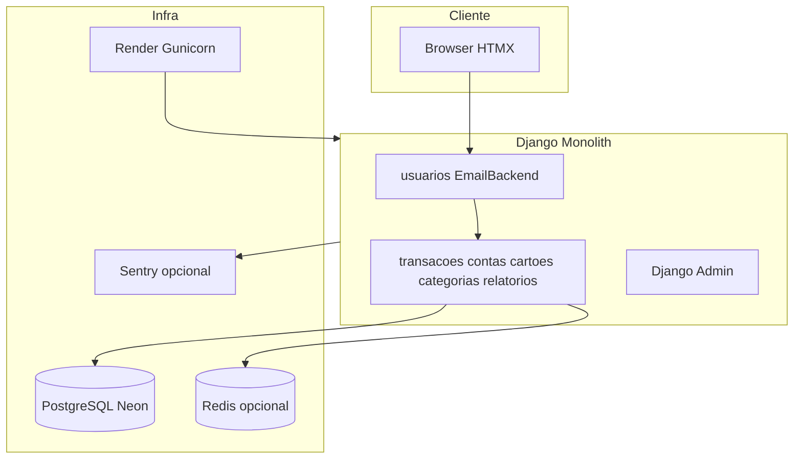

# Relatório de Auditoria Completa — Segurança, Privacidade e LGPD

**Produto:** GranaGo — SaaS de gestão financeira pessoal  
**Stack:** Django 5.2, PostgreSQL (Neon), Render, HTMX, Tailwind  
**Data da auditoria:** 17/06/2026  
**Versão do relatório:** 1.0  
**Escopo:** Código, arquitetura, settings, middlewares, autenticação, autorização, views, templates, APIs, models, uploads, logs, headers, sessão, banco de dados, dependências, infraestrutura, deploy, CI/CD, LGPD  
**Metodologia:** OWASP Top 10 (2021), OWASP ASVS 4.0, boas práticas Django, DevSecOps, Lei 13.709/2018 (LGPD)

> **Nota:** Relatório histórico de 17/06/2026. O checklist vivo de pendências está em [`01_SEGURANCA_PRIVACIDADE_COMPLIANCE.md`](01_SEGURANCA_PRIVACIDADE_COMPLIANCE.md). Nenhuma alteração de código foi realizada nesta auditoria — apenas documentação e diagnóstico.

---

## Índice

1. [Sumário Executivo](#1-sumário-executivo)
2. [Fase 1 — Mapeamento do Sistema](#2-fase-1--mapeamento-do-sistema)
3. [Fase 2 — Auditoria de Segurança](#3-fase-2--auditoria-de-segurança)
4. [Fase 3 — LGPD e Privacidade](#4-fase-3--lgpd-e-privacidade)
5. [Fase 4 — Banco de Dados](#5-fase-4--banco-de-dados)
6. [Fase 5 — DevSecOps](#6-fase-5--devsecops)
7. [Fase 6 — Relatório Final](#7-fase-6--relatório-final)
8. [To-Dos de Implementação](#8-to-dos-de-implementação)
9. [Referências e Anexos](#9-referências-e-anexos)

---

## 1. Sumário Executivo

### 1.1 Contexto

O GranaGo é um SaaS financeiro multi-tenant por usuário, desenvolvido em Django. Cada titular possui dados financeiros sensíveis (transações, contas, cartões, faturas, orçamentos, investimentos). O isolamento de dados é feito via FK `usuario` em todos os models financeiros. O produto visa lançamento comercial com padrão profissional de segurança.

### 1.2 Score Geral de Segurança

| Classificação | **Aceitável** |
|---------------|---------------|
| Pronto para lançamento comercial | **Não** (sem correções P1/P2) |
| Enterprise-ready | **Não** |
| MVP interno / beta fechado | **Sim**, com ressalvas |

**Justificativa:** O isolamento multi-tenant está bem implementado e testado, mas lacunas críticas em autenticação (brute force), XSS armazenado, defaults inseguros de configuração e conformidade LGPD impedem classificação como "bom" ou "alto nível" para um SaaS financeiro comercial.

### 1.3 Matriz por Dimensão

| Dimensão | Score | Comentário |
|----------|-------|------------|
| Isolamento multi-tenant | **Bom** | Filtro `usuario=request.user` consistente; testes IDOR/CSRF |
| Autenticação | **Aceitável** | Login sólido; sem rate limit, MFA, reset de senha |
| Autorização | **Bom** | Todas as views financeiras protegidas |
| CSRF / XSS | **Aceitável** | CSRF OK; XSS em JS de categorias |
| Headers / hardening | **Aceitável** | HSTS/SSL em prod; sem CSP |
| Uploads | **Aceitável** | Validações parciais; inconsistência de limites |
| Logging / observabilidade | **Aceitável** | Sentry sem PII; sem audit trail |
| LGPD / privacidade | **Ruim** | Sem políticas, exclusão, consentimento |
| DevSecOps | **Aceitável** | CI com testes segurança; sem scan de deps |
| Infraestrutura | **Aceitável** | Render + Neon; mídia efêmera |

### 1.4 Top 10 Riscos Críticos

| # | ID | Risco | Severidade |
|---|-----|-------|------------|
| 1 | SEC-P1-01 | Brute force ilimitado em `/login/` | Alta |
| 2 | SEC-P1-02 | XSS armazenado em categorias (innerHTML) | Alta |
| 3 | SEC-P1-03 | `SECRET_KEY` hardcoded como default | Alta |
| 4 | LGPD-P1-01 | Ausência de política de privacidade e termos | Alta |
| 5 | LGPD-P1-02 | Sem fluxo de exclusão de conta pelo titular | Alta |
| 6 | SEC-P2-01 | Sem Content-Security-Policy | Média |
| 7 | SEC-P2-02 | Rotas benchmark com `@csrf_exempt` sem auth | Média |
| 8 | SEC-P2-03 | HTMX via CDN sem SRI | Média |
| 9 | INFRA-P2-01 | Mídia em disco efêmero (Render free) | Média |
| 10 | LGPD-P2-01 | Exportação parcial — sem pacote LGPD completo | Média |

### 1.5 Recomendação Go/No-Go

| Cenário | Recomendação |
|---------|--------------|
| Lançamento comercial público | **NO-GO** até P1 resolvidos + páginas legais LGPD |
| Beta fechado (admin provisiona usuários) | **GO** com monitoramento e plano de correção 30 dias |
| Auditoria para investidores/compliance | Usar este relatório + roadmap como evidência de maturidade em progresso |

---

## 2. Fase 1 — Mapeamento do Sistema

### 2.1 Estrutura Geral

#### 2.1.1 Apps Django e Responsabilidades

| App | Arquivos-chave | Responsabilidade |
|-----|----------------|------------------|
| **usuarios** | `models.py`, `views.py`, `backends.py`, `signals.py` | Autenticação por e-mail, modelo `Usuario` + `Perfil`, configurações, onboarding |
| **transacoes** | `models.py`, `views.py`, `ofx_parse.py`, `signals.py` | CRUD transações, histórico, gráficos, importação OFX/XLSX |
| **contas** | `models.py`, `views.py` | Contas bancárias/carteira com saldo calculado |
| **cartoes** | `models.py`, `views.py`, `services/` | Cartões, faturas, pagamento, movimentação de lançamentos |
| **categorias** | `models.py`, `views.py` | Categorias receita/despesa (globais + por usuário) |
| **relatorios** | `views.py`, `api_views.py`, `services/`, `export/` | Dashboard, relatórios, orçamentos, exportação CSV/XLSX/PDF |
| **config** | `settings.py`, `urls.py`, `middleware.py`, `observability.py` | Settings, URLs raiz, middleware, Sentry |

**Módulos auxiliares (não em INSTALLED_APPS):** `core/` (utilitários), `financial_contracts/` (contratos de teste).

#### 2.1.2 Diagrama de Arquitetura



#### 2.1.3 Fluxo de Autenticação

```
POST /login/ (email + senha)
    → authenticate() via EmailBackend (usuarios/backends.py)
    → Verifica ativo=True
    → login() → sessão cached_db (24h)
    → Redirect relatorios:home

POST /logout/ → LogoutView → invalida sessão → /login/

/configuracoes/senha/ → PasswordChangeForm + update_session_auth_hash()
```

**Arquivos:** `usuarios/views.py`, `usuarios/backends.py`, `config/settings.py` (linhas 210-218).

**Não implementado:** reset de senha, cadastro público, verificação de e-mail, MFA.

#### 2.1.4 Fluxo de Dados Sensíveis

```
Entrada:
  - Formulários web (transações, contas, configurações)
  - Upload OFX/XLSX (memória → Transacao)
  - Upload foto perfil → media/perfis/fotos/

Persistência:
  - PostgreSQL (models com FK usuario)
  - media/exports/{usuario_id}/ (ExportJob)
  - Sessões (cached_db)
  - Cache Redis/LocMem (agregações dashboard)

Saída:
  - Templates HTML (auto-escape Django)
  - APIs JSON (relatorios/api_views.py, transacoes/views.py)
  - Export CSV/XLSX/PDF (download autenticado)
  - Sentry (erros, sem PII default)
```

#### 2.1.5 Dependências Críticas

| Pacote | Versão | Uso |
|--------|--------|-----|
| Django | 5.2 | Framework |
| gunicorn | 23.0.0 | WSGI produção |
| whitenoise | 6.9.0 | Static files |
| psycopg2-binary | 2.9.12 | PostgreSQL |
| sentry-sdk | 2.19.2 | Observabilidade |
| celery | 5.4.0 | Export assíncrono (opcional) |
| redis | 5.2.1 | Cache/broker (opcional) |
| ofxparse | 0.21 | Parse OFX |
| openpyxl | 3.1.5 | Import/export XLSX |
| weasyprint | 63.1 | PDF |
| Pillow | >=12.0.0 | Imagens |
| django-htmx | 1.21.0 | Partials HTMX |

#### 2.1.6 Integrações Externas

| Integração | Uso | Dados trafegados |
|------------|-----|------------------|
| Render | Hosting web | Todo o tráfego HTTP |
| Neon PostgreSQL | Banco principal | Todos os dados persistidos |
| Redis (opcional) | Cache dashboard, Celery | Agregações financeiras |
| Sentry (opcional) | Erros e traces | Stack traces (PII desligado) |
| Google Fonts CDN | Tipografia | IP do usuário (terceiro) |
| unpkg.com | HTMX 2.0.4 | Supply chain risk |

**Não existe:** Stripe/billing, OAuth social, S3, envio de e-mail transacional.

#### 2.1.7 Superfícies de Ataque

| Superfície | Endpoints | Risco |
|------------|-----------|-------|
| Login | `/login/` | Brute force |
| Admin Django | `/admin/` | Brute force, acesso cross-tenant |
| Uploads | OFX, XLSX, foto perfil | Malware, DoS |
| APIs JSON | `/relatorios/api/*`, `/transacoes/api/*` | IDOR (mitigado), enumeração |
| Benchmark (condicional) | `/__benchmark/*` | CSRF exempt, info disclosure |
| Debug (condicional) | `/silk/`, `/__debug__/` | Exposição total de queries |
| Media (DEBUG only) | `/media/` | Exposição de arquivos |

### 2.2 Dados Sensíveis

#### 2.2.1 Inventário Completo

| Model / Local | Dados Pessoais | Dados Financeiros | Criticidade |
|---------------|----------------|-------------------|-------------|
| `Usuario` | email, nome, data_nascimento, last_login | — | Alta |
| `Perfil` | foto | moeda, preferências, ocultar_valores | Média |
| `Transacao` | descricao (PII indireta) | valor, data, tipo, ofx_fitid | **Crítica** |
| `Conta` | nome | tipo, saldo derivado | Alta |
| `Cartao` | nome | limite, dias fechamento/vencimento | Alta |
| `Fatura` | — | valor_total, datas ciclo, status | Alta |
| `Categoria` | nome, descricao | — | Média |
| `OrcamentoCategoria` | — | valor_planejado | Média |
| `ExportJob` | filtros_json | arquivo exportado completo | **Crítica** |
| Sessões | sessionid | — | Média |
| Cache dashboard | — | agregações financeiras | Média |
| localStorage | preferências UI | — | Baixa |

#### 2.2.2 Dados que Deveriam ser Criptografados

| Dado | Estado atual | Recomendação |
|------|--------------|--------------|
| Senhas | Hash PBKDF2 (Django) | OK |
| Valores financeiros | Texto/claro no DB | Criptografia em repouso via Neon; field-level opcional |
| Arquivos export | Disco sem encrypt app | S3 com SSE ou encrypt-at-rest do provedor |
| Fotos perfil | Disco sem encrypt app | Storage gerenciado com encryption |
| ofx_fitid | Texto/claro | Baixa prioridade |

#### 2.2.3 Dados que Deveriam ser Mascarados

| Contexto | Implementação atual |
|----------|---------------------|
| Dashboard | `Perfil.ocultar_valores_dashboard` — OK |
| Logs | Parcial — `erro_interno` pode conter dados financeiros |
| Sentry | `send_default_pii=False` — OK |
| Admin | Sem mascaramento — staff vê tudo |

#### 2.2.4 Dados que NÃO Deveriam ser Logados

- Senhas, tokens de sessão, CSRF tokens
- Valores de transações em plaintext em logs de aplicação
- Stack traces completos com dados de request em produção
- Email em rotas de benchmark (`ping_auth`)

### 2.3 Multi-Tenant

#### 2.3.1 Modelos com FK `usuario`

| Model | Isolamento |
|-------|------------|
| `Transacao`, `Conta`, `Cartao`, `Fatura` | Total |
| `OrcamentoCategoria`, `ExportJob` | Total |
| `Perfil` | OneToOne |
| `Categoria` | Parcial — `padrao=True` compartilhadas globalmente |

#### 2.3.2 Padrão de Defesa

```python
# Padrão dominante em views
get_object_or_404(Modelo, pk=pk, usuario=request.user)
Modelo.objects.filter(usuario=request.user)
```

Validação adicional em `Transacao.clean()` e forms (`PreferenciasFinanceirasForm`, `TransacaoForm`).

#### 2.3.3 Riscos IDOR Identificados

| Local | Risco | Severidade |
|-------|-------|------------|
| Views HTTP | Mitigado | Baixo |
| `historico_categoria_orcamento` | `categoria_id` sem validar ownership | Baixo |
| `relatorios/services/orcamentos.py:410` | Query interna sem filtro usuario | Baixo |
| Django Admin | Staff acessa todos os tenants | Esperado |

**Testes:** `usuarios/tests/test_seguranca.py` — 16 testes unitários + contratos skipped para rate limit e auditoria.

---

## 3. Fase 2 — Auditoria de Segurança

### 3.1 Autenticação

| Controle | Status | Detalhes |
|----------|--------|----------|
| Força de senha | Parcial | 4 validadores Django padrão; min 8 chars |
| Políticas de senha customizadas | Ausente | Sem requisito de complexidade |
| Brute force protection | **Ausente** | `usuarios/views.py` — POST ilimitado |
| Rate limiting geral | Parcial | Só export (10/hora) |
| Session fixation | OK | Django regenera session key no login |
| Session hijacking | Parcial | HttpOnly + Secure em prod; SameSite=Lax |
| Reset de senha | **Ausente** | Sem `PasswordResetView`, sem EMAIL_* |
| Timeout de sessão | 24h fixo | `SESSION_COOKIE_AGE=86400` |
| Remember me | Não existe | Sessão persiste 24h |
| MFA/2FA | **Ausente** | — |
| Reutilização de sessão | OK | `update_session_auth_hash` na troca de senha |
| Usuário inativo | OK | `EmailBackend` bloqueia `ativo=False` |
| Enumeração de email | OK | Mensagem genérica no login |

### 3.2 Autorização

| Controle | Status |
|----------|--------|
| `@login_required` em FBVs | OK |
| `LoginRequiredMixin` em CBVs | OK |
| RBAC além de staff | Ausente |
| Validação server-side em forms | OK |
| Endpoints públicos financeiros | Nenhum |

### 3.3 CSRF / XSS

| Controle | Status | Detalhes |
|----------|--------|----------|
| CsrfViewMiddleware | Ativo | `config/settings.py:77` |
| `` | Presente | Formulários e AJAX |
| `mark_safe` / `\|safe` | **Nenhum** | Bom |
| XSS em templates Django | Baixo risco | Auto-escape |
| XSS em JavaScript | **VULNERÁVEL** | `categorias/static/categorias/js/adicionar_categoria.js` |
| CSP | **Ausente** | — |
| HTMX CDN | Sem SRI | `templates/base.html` |

**Vulnerabilidade SEC-P1-02 — XSS armazenado em categorias:**

- **Arquivo:** `categorias/static/categorias/js/adicionar_categoria.js` (linhas 449-493)
- **Causa:** `renderIconBox` e `renderCategoriaRowInner` injetam `result.nome`, `result.icone`, `result.cor` via `innerHTML`
- **Server-side:** `categorias/views.py` aceita `icone` e `cor` do POST sem whitelist
- **Exploração:** Atacante autenticado cria categoria com nome `` ou icone malicioso; payload executa para qualquer usuário que visualize a lista
- **Impacto:** Roubo de sessão, ações em nome da vítima, exfiltração de dados financeiros
- **Correção:** Escape HTML (`textContent`/`createElement`); whitelist de ícones FontAwesome e cores hex no servidor

### 3.4 SQL Injection

| Vetor | Status |
|-------|--------|
| ORM Django | OK — uso predominante |
| Raw SQL em app | Apenas `config/benchmark_views.py` — `SELECT 1` literal |
| Raw SQL em migrations | N/A (legado SQLite) |

**Risco: Baixo** na lógica de aplicação.

### 3.5 Uploads

| Fluxo | Limites | Validação | Risco |
|-------|---------|-----------|-------|
| Foto perfil | 2 MB | MIME whitelist | Baixo |
| OFX | 6 MB, 2000 linhas | Parser ofxparse | Médio — sem validação extensão |
| XLSX | 6 MB | Extensão `.xlsx` | Médio |
| Export download | 50 MB | Auth + ownership | Baixo |

**Inconsistência:** Views permitem 6 MB mas `DATA_UPLOAD_MAX_MEMORY_SIZE` default Django é 2.5 MB — uploads 2.5-6 MB falham antes da view.

### 3.6 Headers de Segurança

| Header | Produção (DEBUG=False) | Status |
|--------|------------------------|--------|
| HSTS | 31536000s, subdomains, preload | OK |
| X-Frame-Options | DENY | OK |
| X-Content-Type-Options | nosniff | OK |
| Referrer-Policy | same-origin | OK |
| Content-Security-Policy | — | **Ausente** |
| Permissions-Policy | — | **Ausente** |
| Cross-Origin-Opener-Policy | — | Ausente |
| Cross-Origin-Resource-Policy | — | Ausente |

### 3.7 Cookies e Sessão

| Setting | Valor |
|---------|-------|
| SESSION_ENGINE | cached_db |
| SESSION_COOKIE_AGE | 86400 (24h) |
| SESSION_COOKIE_HTTPONLY | True |
| SESSION_COOKIE_SAMESITE | Lax |
| SESSION_COOKIE_SECURE | True (prod) |
| CSRF_COOKIE_SECURE | True (prod) |
| SESSION_SAVE_EVERY_REQUEST | Não configurado |

### 3.8 APIs

| API | Auth | Rate limit | IDOR |
|-----|------|------------|------|
| `/relatorios/api/serie-tendencia/` | Sessão | Não | Mitigado |
| `/relatorios/api/top-categorias/` | Sessão | Não | Mitigado |
| `/relatorios/api/export/jobs/` | Sessão | 10/h | Mitigado |
| `/transacoes/api/grafico/` | Sessão | Não | Mitigado |
| Export share token | Sessão + ownership | — | Token sozinho insuficiente |

### 3.9 Dependências

- **Sem scan automatizado** de CVEs no CI (pip-audit, safety, dependabot)
- Versões pinadas em `requirements.txt` sem hash
- Pacotes críticos atualizados (Django 5.2, gunicorn 23)

### 3.10 Infraestrutura (Settings)

| Item | Estado | Risco |
|------|--------|-------|
| DEBUG default | True | Alto se deploy errado |
| SECRET_KEY default | Hardcoded | Alto |
| ALLOWED_HOSTS em DEBUG | `["*"]` | Aceitável em dev |
| Media em DEBUG | Servida publicamente | Aceitável em dev |
| Silk/Debug Toolbar | Habilitáveis via env sem guard DEBUG | Médio |

### 3.11 Logging

| Fonte | PII exposto | Risco |
|-------|-------------|-------|
| Export observability | user_id numérico | Baixo |
| Perf middleware | Paths HTTP | Baixo |
| ExportJob.erro_interno | Traceback até 2000 chars no DB | **Alto** |
| Sentry | PII desligado | Baixo |
| Gunicorn access log | IPs, paths | Médio |

### 3.12 Hardening

| Controle | Status |
|----------|--------|
| Rate limiting login | Ausente |
| WAF readiness | Parcial — headers básicos |
| Cloudflare readiness | Possível na frente do Render |
| Scraping protection | Ausente |
| Rotas benchmark | `@csrf_exempt` + sem auth se habilitadas |

### 3.13 Lista Detalhada de Vulnerabilidades — Segurança

#### Críticas (P1)

| ID | Descrição | Severidade | Impacto | Exploração | Correção | Arquivos |
|----|-----------|------------|---------|------------|----------|----------|
| SEC-P1-01 | Brute force em login | Alta | Comprometimento de contas | Scripts automatizados POST /login/ | django-axes ou rate limit IP | `usuarios/views.py` |
| SEC-P1-02 | XSS em categorias JS | Alta | Roubo sessão, ações maliciosas | Categoria com payload em nome/icone | Escape HTML + whitelist server | `adicionar_categoria.js`, `categorias/views.py` |
| SEC-P1-03 | SECRET_KEY default hardcoded | Alta | Forja sessões, CSRF tokens | Deploy sem env | Fail-fast se ausente em prod | `config/settings.py:27-30` |
| SEC-P1-04 | DEBUG=True default | Alta | Info disclosure, ALLOWED_HOSTS=* | Misconfig deploy | Fail-fast; DEBUG=False obrigatório prod | `config/settings.py:33` |

#### Importantes (P2)

| ID | Descrição | Severidade | Impacto | Correção | Arquivos |
|----|-----------|------------|---------|----------|----------|
| SEC-P2-01 | Sem CSP | Média | XSS amplificado | django-csp ou middleware | `config/settings.py` |
| SEC-P2-02 | Benchmark routes csrf_exempt | Média | Abuse, reconnaissance | Desabilitar prod; remover exempt | `config/benchmark_views.py` |
| SEC-P2-03 | HTMX CDN sem SRI | Média | Supply chain | Self-host ou SRI | `templates/base.html` |
| SEC-P2-04 | Silk/Debug sem guard DEBUG | Média | Exposição queries/PII | `if DEBUG and ENABLE_SILK` | `config/observability.py` |
| SEC-P2-05 | LocMemCache rate limit | Média | Bypass multi-worker | Redis obrigatório prod | `config/settings.py` |
| SEC-P2-06 | Sem reset senha | Média | Lockout operacional | PasswordResetView + EMAIL | `usuarios/urls.py` |
| SEC-P2-07 | DATA_UPLOAD vs view limit | Baixa | UX/DoS confuso | Alinhar para 6MB | `config/settings.py` |
| SEC-P2-08 | Media disco efêmero | Média | Perda dados | S3/R2 storage | `config/settings.py` |
| SEC-P2-09 | erro_interno em ExportJob | Média | Vazamento em admin | Sanitizar tracebacks | `relatorios/models.py` |

#### Recomendadas (P3)

| ID | Descrição | Correção |
|----|-----------|----------|
| SEC-P3-01 | MFA/2FA | django-otp ou WebAuthn |
| SEC-P3-02 | SESSION_SAVE_EVERY_REQUEST | Renovar expiração a cada request |
| SEC-P3-03 | Validação extensão OFX | Whitelist `.ofx` |
| SEC-P3-04 | Guard categoria_id orçamentos | `Q(usuario=user) \| Q(padrao=True)` |
| SEC-P3-05 | Sincronizar ativo/is_active | Signal ou unificar admin |

### 3.14 Pontos Positivos de Segurança

1. Isolamento multi-tenant consistente com testes automatizados
2. Sem `mark_safe` ou `|safe` em templates
3. CSRF ativo; logout via POST
4. Headers de segurança em produção (HSTS, X-Frame-Options, etc.)
5. Sentry com `send_default_pii=False`
6. Mensagem genérica no login (anti-enumeração)
7. `Transacao.clean()` valida coerência tenant
8. Export jobs com rate limit e ownership check

---

## 4. Fase 3 — LGPD e Privacidade

### 4.1 Base Legal

| Base | Aplicabilidade | Status no sistema |
|------|----------------|-------------------|
| Execução de contrato | Prestação do serviço financeiro | Implícito — sem documentação |
| Consentimento | Marketing, cookies não essenciais | **Não implementado** |
| Legítimo interesse | Analytics, segurança | Parcial — Sentry sem consent banner |
| Obrigação legal | Retenção fiscal (se aplicável) | Não documentado |

### 4.2 Direitos do Titular (Art. 18 LGPD)

| Direito | Status | Evidência |
|---------|--------|-----------|
| Confirmação de tratamento | Ausente | Sem canal/página |
| Acesso | Parcial | Export financeiro em `relatorios/export/` |
| Correção | OK | `/configuracoes/` |
| Anonimização | **Ausente** | — |
| Portabilidade | Parcial | CSV/XLSX/PDF; sem pacote PII completo |
| Eliminação | **Ausente** | Sem fluxo de exclusão de conta |
| Informação sobre compartilhamento | Ausente | Sem política |
| Revogação de consentimento | Ausente | — |
| Oposição | Ausente | — |

### 4.3 Exclusão de Conta

- **Não existe** view/URL para titular excluir própria conta
- `ativo=False` bloqueia login mas **preserva todos os dados**
- Exclusão via Django Admin apaga em cascata (CASCADE em FKs)
- Soft delete em contas/cartões **não elimina** transações históricas

### 4.4 Exportação de Dados

**Implementado (parcial):**
- Hub em `/relatorios/exportar/`
- Domínios: transações, contas, cartões, orçamentos, investimentos, PDF
- Jobs assíncronos com TTL 72h, cleanup 30 dias

**Lacuna LGPD:**
- Não exporta: email, data_nascimento, foto, sessões, metadados de conta
- Não há formato único "pacote do titular" (JSON/ZIP)

### 4.5 Retenção

| Tipo de dado | Política no código |
|--------------|-------------------|
| Export files | 72h TTL + cleanup 30d |
| Sessões | 24h |
| Cache dashboard | 30s |
| Dados financeiros | **Indefinido** |
| Fotos perfil | **Indefinido** |
| Contas inativas (`ativo=False`) | **Indefinido** |

### 4.6 Transparência

| Item | Status |
|------|--------|
| Política de privacidade | **Ausente** |
| Termos de uso | **Ausente** |
| Política de cookies | **Ausente** |
| Banner de consentimento | **Ausente** |
| Registro de consentimento | **Ausente** |
| Canal DPO/privacidade | **Ausente** |

**Terceiros sem disclosure:** Google Fonts, unpkg HTMX.

### 4.6.1 Subprocessador Google AI (Gemini) — Categorização LLM

| Item | Detalhe |
|------|---------|
| **Subprocessador** | Google LLC — API Gemini (`generativelanguage.googleapis.com`) |
| **Finalidade** | Sugestão de categoria em transações de baixa confiança do pipeline híbrido |
| **Base legal** | Legítimo interesse / execução de contrato — habilitado exclusivamente pelo admin (`ENABLE_CATEGORIZACAO_LLM`) |
| **Controle** | Admin via deploy/env; usuário final **não** opta por usar IA |
| **Dados enviados** | Descrição normalizada, merchant_key anonimizado, tipo receita/despesa, faixa de valor, lista de slugs de categorias |
| **Dados não enviados** | Nome, e-mail, CPF, valor exato, conta bancária, histórico completo |
| **Redação PIX** | `redact_pii_for_llm()` substitui nomes por `[PESSOA]` antes do prompt |
| **Retenção local** | `LLMRequestLog` — 90 dias recomendados; apenas hash da descrição, sem payload bruto |
| **Cache** | Por usuário; TTL configurável (`CATEGORIZACAO_LLM_CACHE_TTL_H`, default 168h) |
| **Transferência internacional** | EUA — requer disclosure na política de privacidade |
| **Kill switch** | `ENABLE_CATEGORIZACAO_LLM=False` desativa envio imediato |
| **Auto-aplicação** | LLM **nunca** auto-aplica categoria na v1 (`fonte=llm_gemini`) |
| **Documentação técnica** | [`docs/llm/ROLLOUT.md`](../llm/ROLLOUT.md) |

**Status:** implementado com opt-in; política de privacidade e DPIA ainda pendentes antes de GA.

### 4.7 Segurança Exigida pela LGPD (Art. 46)

| Medida | Status |
|--------|--------|
| Criptografia em trânsito | OK (HTTPS prod) |
| Criptografia em repouso | Parcial (Neon); app não encrypta campos |
| Controle de acesso | OK (multi-tenant) |
| Segregação | OK (por usuario) |
| Auditoria | **Ausente** |
| Rastreabilidade | Parcial (timestamps em models) |

### 4.8 Logs e Auditoria

- **Sem audit log** de ações críticas (login, export, exclusão, pagamento fatura)
- Teste skipped: `SKIP-SEC-AUD-01` em `usuarios/tests/test_seguranca.py`
- `ExportJob.erro_interno` pode persistir dados sensíveis em tracebacks

### 4.9 Incidentes

| Item | Status |
|------|--------|
| Plano de resposta a incidentes | Ausente |
| Procedimento notificação ANPD/titulares | Ausente |
| Detecção de vazamentos | Parcial (Sentry para erros) |

### 4.10 Matriz de Conformidade LGPD

| Requisito | Status | Prioridade correção |
|-----------|--------|---------------------|
| Política de privacidade | Falha | P1 |
| Termos de uso | Falha | P1 |
| Consentimento cookies | Falha | P1 |
| Exclusão de conta | Falha | P1 |
| Exportação completa | Parcial | P2 |
| Audit trail | Falha | P2 |
| Retenção documentada | Parcial | P2 |
| Anonimização | Falha | P3 |
| DPO designado | Falha | P3 (processo) |

---

## 5. Fase 4 — Banco de Dados

### 5.1 Configuração

- **Engine:** PostgreSQL via `DATABASE_URL` (Neon) ou `DB_*` individuais
- **SSL:** Documentado em `.env.example` (`sslmode=require`)
- **Pool:** `conn_max_age=600` (prod), health checks ativos
- **Timeout:** `connect_timeout=5`

### 5.2 Segurança

| Aspecto | Status |
|---------|--------|
| Criptografia em repouso | Depende do Neon (geralmente disponível) |
| Criptografia de campo no ORM | Ausente |
| Privilégios DB | Não documentados no repo |
| SQL injection | Baixo risco (ORM) |
| Admin cross-tenant | Staff vê todos os dados |

### 5.3 Backups

- **Nenhum script** `pg_dump`/restore no repositório
- Backup depende do provedor Neon
- Sem política de retenção de backups documentada
- Sem teste de restore automatizado

### 5.4 Índices e Performance

- Índices em models para queries frequentes
- Dashboard cache reduz carga de agregações
- Silk disponível para profiling (não usar em prod)

### 5.5 Segregação de Ambiente

- CI E2E usa SQLite (diverge de prod)
- CI migrations usa Postgres 16 service
- `.env` gitignored — correto

### 5.6 Dumps Inseguros

- Nenhum dump commitado no repo
- Risco operacional: dumps manuais sem procedimento

---

## 6. Fase 5 — DevSecOps

### 6.1 Pipeline CI/CD

| Workflow | Trigger | Conteúdo |
|----------|---------|----------|
| `e2e.yml` | push/PR | Testes `-m seguranca`, performance, e2e Playwright |
| `migrations.yml` | PR migrations | Postgres 16; `continue-on-error: true` |
| `synthetic-monitoring.yml` | cron 10min | Smoke tests |

**Gaps:**
- Sem pip-audit, safety, bandit, semgrep
- Sem Dependabot/Renovate
- Sem job de deploy (Render blueprint separado)
- E2E principal não usa Postgres

### 6.2 Secrets

| Item | Status |
|------|--------|
| `.env` no repo | Não (gitignored) |
| SECRET_KEY hardcoded default | **Sim** — risco |
| Senhas em testes e2e | Placeholder aceitável |
| Render SECRET_KEY | `generateValue: true` — OK |

### 6.3 Deploy (Render)

```yaml
# render.yaml
DEBUG: "False"
SECRET_KEY: generateValue: true
EXPORT_JOB_BACKEND: thread
WEB_CONCURRENCY: 1
```

**Riscos:**
- Plano free — disco efêmero
- Export em thread no mesmo worker
- `DJANGO_SUPERUSER_*` declaradas mas `create_superuser` não no buildCommand

### 6.4 Containers

- **Docker inexistente** — sem Dockerfile, docker-compose
- Sem scan de imagens

### 6.5 Scans Automatizados

| Scan | Status |
|------|--------|
| SAST | Ausente |
| Dependency CVE | Ausente |
| Secret scanning | Ausente (exceto gitignore) |
| DAST | Ausente |

### 6.6 Middleware de Segurança

```
SecurityMiddleware → WhiteNoise → Session → Common → CSRF
→ Auth → PrefetchUserPerfil → Messages → XFrameOptions → Htmx
[+ PerfTiming, MinifyHtml condicionais]
```

`PrefetchUserPerfilMiddleware` — otimização, sem lógica de segurança.

---

## 7. Fase 6 — Relatório Final

### 7.1 Score Consolidado

```
Isolamento multi-tenant  ████████░░  Bom
Autenticação             █████░░░░░  Aceitável
LGPD                     ██░░░░░░░░  Ruim
DevSecOps                █████░░░░░  Aceitável
Infraestrutura           █████░░░░░  Aceitável
─────────────────────────────────────
GERAL                    █████░░░░░  Aceitável
```

**Classificação final: Aceitável** — adequado para beta fechado; **inadequado para lançamento comercial público** sem correções P1 e adequação LGPD básica.

### 7.2 Melhorias Recomendadas por Prioridade

#### Críticas (bloqueiam lançamento comercial)

1. Rate limit no login
2. Corrigir XSS em categorias
3. Fail-fast SECRET_KEY/DEBUG em produção
4. Política de privacidade e termos de uso
5. Fluxo de exclusão de conta

#### Importantes (30-60 dias)

6. Content-Security-Policy
7. Reset de senha com provedor de e-mail
8. Exportação LGPD completa (pacote titular)
9. Sanitizar `erro_interno` em ExportJob
10. Storage persistente (S3) para media
11. Redis para cache/rate limit em produção
12. Desabilitar/guardar rotas benchmark e debug tools

#### Recomendadas (60-90 dias)

13. Audit log de ações sensíveis
14. Banner de cookies + registro de consentimento
15. Política de retenção documentada e automatizada
16. Scan de dependências no CI
17. Self-host HTMX ou SRI

#### Futuras (roadmap longo prazo)

18. MFA/2FA
19. WAF/Cloudflare
20. Criptografia seletiva de campos
21. Processo de resposta a incidentes + DPO
22. Billing e planos (app separado)

### 7.3 Roadmap de Implementação

#### Quick Wins (1-2 semanas)

| Item | Esforço | Impacto |
|------|---------|---------|
| Fail-fast SECRET_KEY/DEBUG | 2h | Alto |
| XSS categorias (escape + whitelist) | 4h | Alto |
| Guard Silk/Debug só em DEBUG | 1h | Médio |
| Garantir ENABLE_BENCHMARK_ROUTES=False prod | 1h | Médio |
| CSP básica (report-only inicial) | 4h | Médio |
| Alinhar DATA_UPLOAD_MAX_MEMORY_SIZE | 1h | Baixo |

#### Curto Prazo (1 mês)

| Item | Esforço | Impacto |
|------|---------|---------|
| Rate limit login (django-axes) | 1d | Alto |
| Páginas /privacidade e /termos | 2d | Alto |
| EMAIL_* + PasswordResetView | 2d | Alto |
| Sanitizar erro_interno | 4h | Médio |
| Self-host HTMX | 2h | Médio |
| pip-audit no CI | 4h | Médio |

#### Médio Prazo (2-3 meses)

| Item | Esforço | Impacto |
|------|---------|---------|
| Exclusão de conta com cascata/anonimização | 1w | Alto |
| Export LGPD completo (ZIP/JSON) | 1w | Alto |
| Audit log model + middleware | 1w | Alto |
| S3/R2 para media e exports | 3d | Alto |
| Redis obrigatório prod | 2d | Médio |
| Cookie consent banner | 3d | Médio |

#### Longo Prazo (3-6 meses)

| Item | Esforço | Impacto |
|------|---------|---------|
| MFA TOTP/WebAuthn | 2w | Alto |
| WAF Cloudflare | 3d | Alto |
| Plano resposta incidentes | 1w | Alto |
| App billing (Stripe) | 4w | Negócio |
| Criptografia field-level | 2w | Médio |

### 7.4 Checklist de Lançamento Seguro

| # | Item | Status | Prioridade | Esforço | Impacto |
|---|------|--------|------------|---------|---------|
| 1 | SECRET_KEY forte via env (sem default) | Pendente | P1 | 2h | Alto |
| 2 | DEBUG=False em produção | OK (Render) | P1 | — | Alto |
| 3 | Rate limit login | Pendente | P1 | 1d | Alto |
| 4 | XSS categorias corrigido | Pendente | P1 | 4h | Alto |
| 5 | Política de privacidade publicada | Pendente | P1 | 2d | Alto |
| 6 | Termos de uso publicados | Pendente | P1 | 2d | Alto |
| 7 | Exclusão de conta | Pendente | P1 | 1w | Alto |
| 8 | ALLOWED_HOSTS restrito | OK (prod) | P2 | — | Alto |
| 9 | CSRF_TRUSTED_ORIGINS configurado | OK (Render) | P2 | — | Alto |
| 10 | HSTS/SSL cookies | OK (prod) | P2 | — | Alto |
| 11 | CSP implementada | Pendente | P2 | 4h | Médio |
| 12 | Reset de senha | Pendente | P2 | 2d | Médio |
| 13 | Storage persistente media | Pendente | P2 | 3d | Alto |
| 14 | Redis cache prod | Pendente | P2 | 2d | Médio |
| 15 | Benchmark routes desabilitadas | OK (default) | P2 | — | Médio |
| 16 | Silk/Debug desabilitados prod | Pendente guard | P2 | 1h | Alto |
| 17 | Scan deps no CI | Pendente | P2 | 4h | Médio |
| 18 | Export LGPD completo | Pendente | P2 | 1w | Alto |
| 19 | Audit log | Pendente | P2 | 1w | Médio |
| 20 | MFA | Pendente | P3 | 2w | Alto |
| 21 | Cookie consent | Pendente | P3 | 3d | Médio |
| 22 | Plano incidentes | Pendente | P3 | 1w | Médio |
| 23 | Testes IDOR/CSRF passando | OK | — | — | Alto |
| 24 | Sentry configurado prod | Opcional | P3 | 2h | Médio |
| 25 | Backup/restore testado | Pendente | P2 | 1d | Alto |

---

## 8. To-Dos de Implementação

Lista acionável para acompanhamento. Marque `- [x]` conforme concluído.

### Quick Wins (1-2 semanas)

- [ ] **SEC-P1-03** — Remover default hardcoded de `SECRET_KEY`; fail-fast se ausente quando `DEBUG=False` — `config/settings.py`
- [ ] **SEC-P1-04** — Fail-fast se `DEBUG=True` em ambiente de produção (detectar `RENDER` ou env `ENVIRONMENT=production`) — `config/settings.py`
- [ ] **SEC-P1-02** — Corrigir XSS em `adicionar_categoria.js`: usar `textContent`/`createElement` em vez de `innerHTML` para dados do usuário — `categorias/static/categorias/js/adicionar_categoria.js`
- [ ] **SEC-P1-02b** — Validar `icone` (whitelist FontAwesome) e `cor` (regex hex) server-side — `categorias/views.py`
- [ ] **SEC-P2-04** — Adicionar guard `DEBUG=True` para habilitar Silk e Debug Toolbar — `config/observability.py`
- [ ] **SEC-P2-02** — Documentar e garantir `ENABLE_BENCHMARK_ROUTES=False` em produção; remover `@csrf_exempt` de `ping` — `config/benchmark_views.py`, `render.yaml`
- [ ] **SEC-P2-01** — Implementar CSP em modo report-only; evoluir para enforce — `config/settings.py` ou `django-csp`
- [ ] **SEC-P2-07** — Definir `DATA_UPLOAD_MAX_MEMORY_SIZE = 6 * 1024 * 1024` — `config/settings.py`
- [ ] **SEC-P2-03** — Self-host HTMX em `static/vendor/` (como Font Awesome) ou adicionar SRI — `templates/base.html`

### Curto Prazo (1 mês)

- [ ] **SEC-P1-01** — Implementar rate limit no login (`django-axes` ou `django-ratelimit`); implementar teste `SKIP-SEC-RL-01` — `usuarios/views.py`, `config/settings.py`
- [ ] **SEC-P2-06** — Configurar `EMAIL_*` (Resend/SES) e fluxo `PasswordResetView` — `usuarios/urls.py`, `config/settings.py`
- [ ] **LGPD-P1-01** — Criar página `/privacidade/` com política de privacidade — `usuarios/urls.py`, template
- [ ] **LGPD-P1-02** — Criar página `/termos/` com termos de uso — `usuarios/urls.py`, template
- [ ] **LGPD-P1-03** — Adicionar links para privacidade/termos no login e rodapé — `templates/base.html`
- [ ] **SEC-P2-09** — Sanitizar `erro_interno` em ExportJob antes de persistir (remover dados de query/request) — `relatorios/services/export/jobs.py`
- [ ] **DEV-P2-01** — Adicionar `pip-audit` ou `safety` no CI — `.github/workflows/e2e.yml`
- [ ] **SEC-P2-05** — Configurar `REDIS_URL` obrigatório em produção para cache e rate limit — `config/settings.py`, `render.yaml`
- [ ] **LGPD-P2-01** — Banner de cookies para recursos de terceiros (Fonts); documentar cookies técnicos — template + JS
- [ ] **SEC-P3-04** — Validar `categoria_id` em `historico_categoria_orcamento` — `relatorios/views.py`

### Médio Prazo (2-3 meses)

- [ ] **LGPD-P1-04** — Implementar fluxo de exclusão de conta pelo titular (confirmação + senha + cascata) — `usuarios/views.py`
- [ ] **LGPD-P2-02** — Exportação LGPD completa: ZIP com perfil + transações + metadados em JSON — `relatorios/export/`
- [ ] **LGPD-P2-03** — Model `AuditLog` para login, export, exclusão, pagamento fatura — novo app ou `usuarios/`
- [ ] **LGPD-P2-03b** — Implementar teste `SKIP-SEC-AUD-01` — `usuarios/tests/test_seguranca.py`
- [ ] **INFRA-P2-01** — Migrar `STORAGES` default para S3/R2 (django-storages) — `config/settings.py`
- [ ] **LGPD-P2-04** — Política de retenção: job para contas `ativo=False` inativas > N meses — management command
- [ ] **DEV-P2-02** — Job E2E com Postgres (alinhar com prod) — `.github/workflows/e2e.yml`
- [ ] **INFRA-P2-02** — Documentar e testar procedimento backup/restore Neon — `docs/`
- [ ] **SEC-P3-05** — Signal sincronizando `ativo` ↔ `is_active` — `usuarios/signals.py`
- [ ] **LGPD-P2-05** — Registro de consentimento no cadastro (quando cadastro público for ativado) — model `Consentimento`

### Longo Prazo (3-6 meses)

- [ ] **SEC-P3-01** — Implementar MFA TOTP (`django-otp`) — `usuarios/`
- [ ] **INFRA-P3-01** — WAF Cloudflare na frente do Render — infra
- [ ] **LGPD-P3-01** — Plano de resposta a incidentes documentado — `docs/`
- [ ] **LGPD-P3-02** — Designar canal DPO/privacidade (email dedicado) — site + política
- [ ] **SEC-P3-02** — `SESSION_SAVE_EVERY_REQUEST = True` — `config/settings.py`
- [ ] **SEC-P3-03** — Validação extensão `.ofx` no upload — `transacoes/views.py`
- [ ] **BIZ-P3-01** — App `billing` com Stripe/planos — novo app
- [ ] **SEC-P3-06** — Criptografia field-level para campos sensíveis (avaliar necessidade) — models
- [ ] **LGPD-P3-03** — Rotina de anonimização pós-exclusão (pseudonimizar descrições) — service
- [ ] **DEV-P3-01** — Dependabot/Renovate para atualizações automáticas — `.github/`

---

## 9. Referências e Anexos

### 9.1 Documentação Interna

- [`docs/performance/README.md`](../performance/README.md) — Benchmarks de performance
- [`docs/seguranca/01_SEGURANCA_PRIVACIDADE_COMPLIANCE.md`](01_SEGURANCA_PRIVACIDADE_COMPLIANCE.md) — Checklist vivo (atual)
- [`.env.example`](../../.env.example) — Variáveis de ambiente
- [`render.yaml`](../../render.yaml) — Blueprint Render

### 9.2 Referências Externas

- [OWASP Top 10 2021](https://owasp.org/Top10/)
- [OWASP ASVS 4.0](https://owasp.org/www-project-application-security-verification-standard/)
- [Django Deployment Checklist](https://docs.djangoproject.com/en/5.2/howto/deployment/checklist/)
- [Lei 13.709/2018 — LGPD](http://www.planalto.gov.br/ccivil_03/_ato2015-2018/2018/lei/l13709.htm)
- [Guia ANPD — Segurança da Informação](https://www.gov.br/anpd/pt-br)

### 9.3 Anexo A — Inventário de Endpoints (resumo)

| App | Endpoints | Protegidos | Públicos |
|-----|-----------|------------|----------|
| usuarios | 6 | 4 | 2 (login, logout) |
| contas | 4 | 4 | 0 |
| categorias | 8 | 8 | 0 |
| cartoes | 7 | 7 | 0 |
| transacoes | 9 | 9 | 0 |
| relatorios | 14+ | 14+ | 0 |
| config | 1+ | 0 | redirect |
| benchmark (cond.) | 4 | 1 | 3 |

### 9.4 Anexo B — Variáveis de Ambiente de Produção

```bash
# Obrigatórias
DEBUG=False
SECRET_KEY=<gerada-50+chars>
DATABASE_URL=postgresql://...?sslmode=require
ALLOWED_HOSTS=app.seudominio.com
CSRF_TRUSTED_ORIGINS=https://app.seudominio.com

# Recomendadas
REDIS_URL=redis://...
SENTRY_DSN=https://...
EXPORT_JOB_BACKEND=celery
ENABLE_BENCHMARK_ROUTES=False
ENABLE_SILK=False
ENABLE_DEBUG_TOOLBAR=False

# E-mail (reset senha)
EMAIL_HOST=...
EMAIL_HOST_USER=...
EMAIL_HOST_PASSWORD=...
DEFAULT_FROM_EMAIL=noreply@seudominio.com
```

### 9.5 Anexo C — Mapeamento OWASP Top 10

| OWASP 2021 | Status GranaGo | Principais achados |
|------------|----------------|-------------------|
| A01 Broken Access Control | Mitigado | IDOR testado; admin cross-tenant esperado |
| A02 Cryptographic Failures | Parcial | HTTPS OK; sem encrypt-at-rest app |
| A03 Injection | Mitigado | ORM; sem raw SQL em app |
| A04 Insecure Design | Parcial | Sem MFA, sem audit log |
| A05 Security Misconfiguration | Risco | DEBUG/SECRET_KEY defaults; benchmark routes |
| A06 Vulnerable Components | Risco | Sem scan automatizado |
| A07 Auth Failures | Risco | Sem rate limit, sem reset senha |
| A08 Software Integrity | Risco | HTMX CDN sem SRI |
| A09 Logging Failures | Parcial | Sentry OK; sem audit trail |
| A10 SSRF | Baixo | Sem fetch de URLs user-controlled |

---

**Fim do relatório.**

*Documento gerado em 17/06/2026. Para implementação das correções, consulte a seção [8. To-Dos de Implementação](#8-to-dos-de-implementação).*
